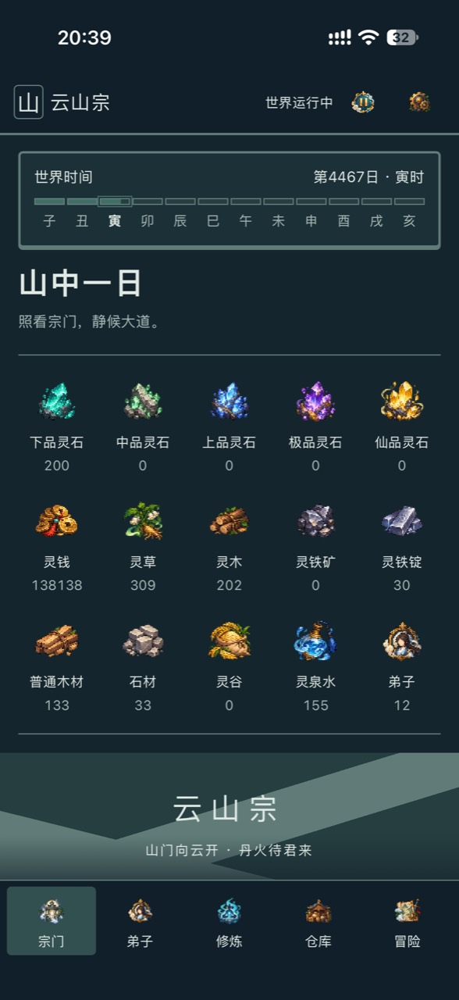
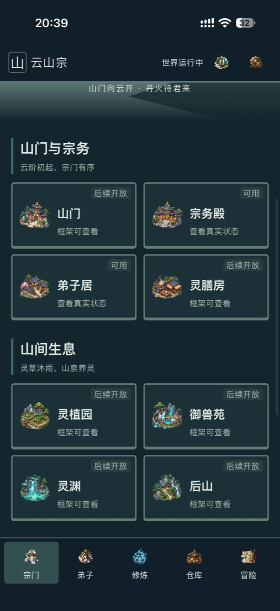
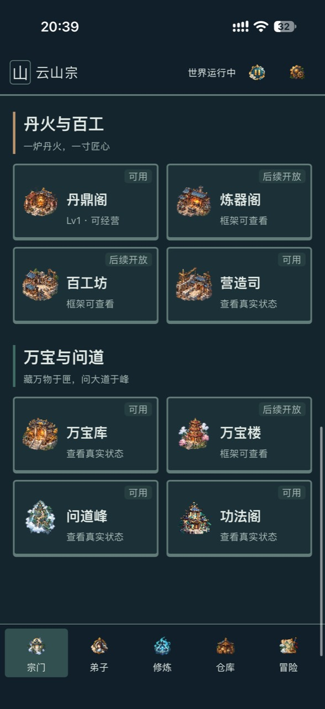
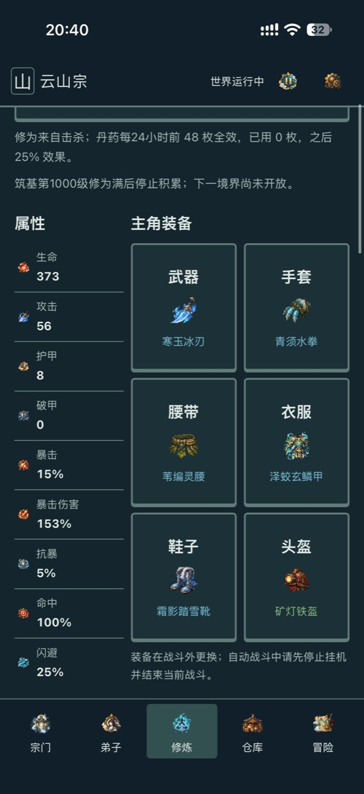
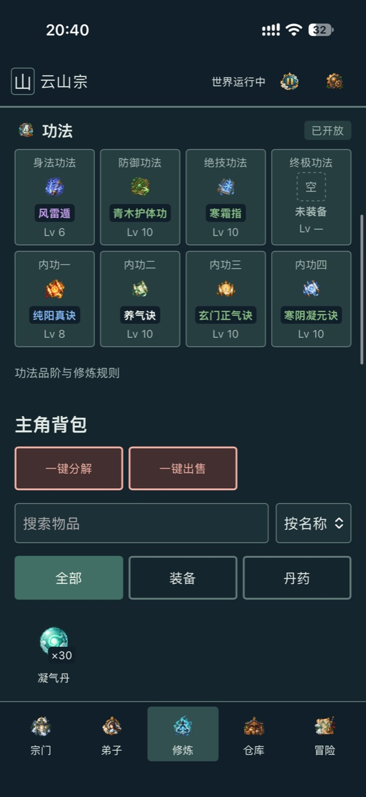
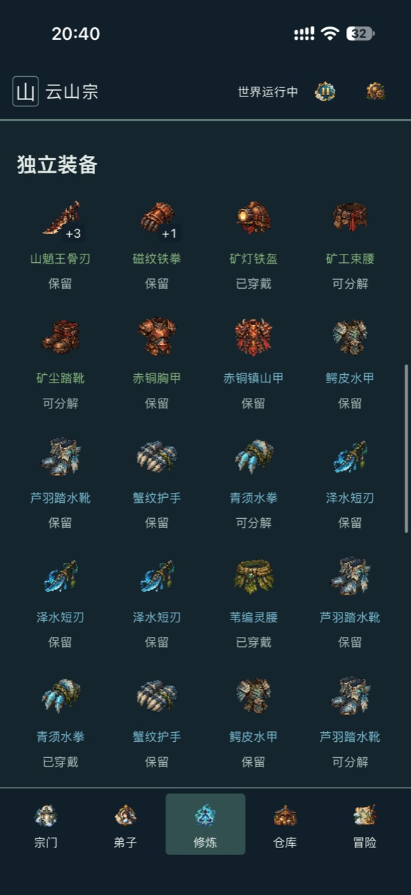
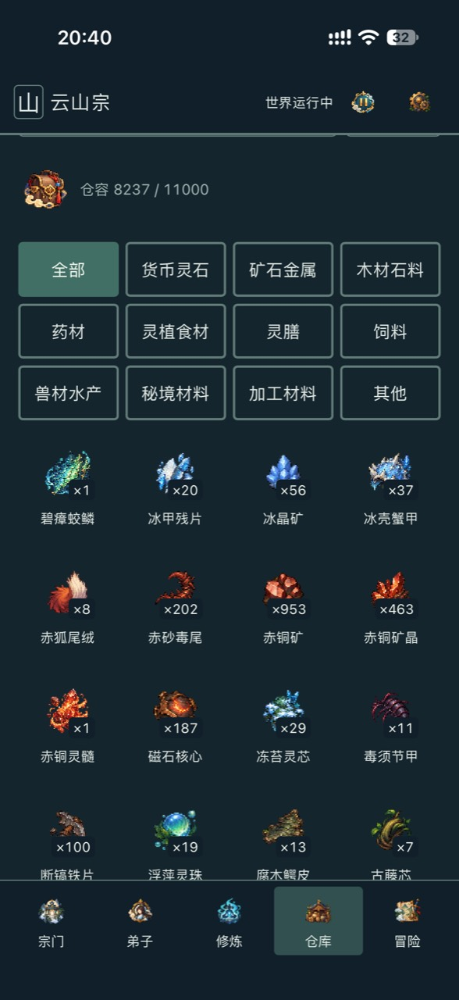
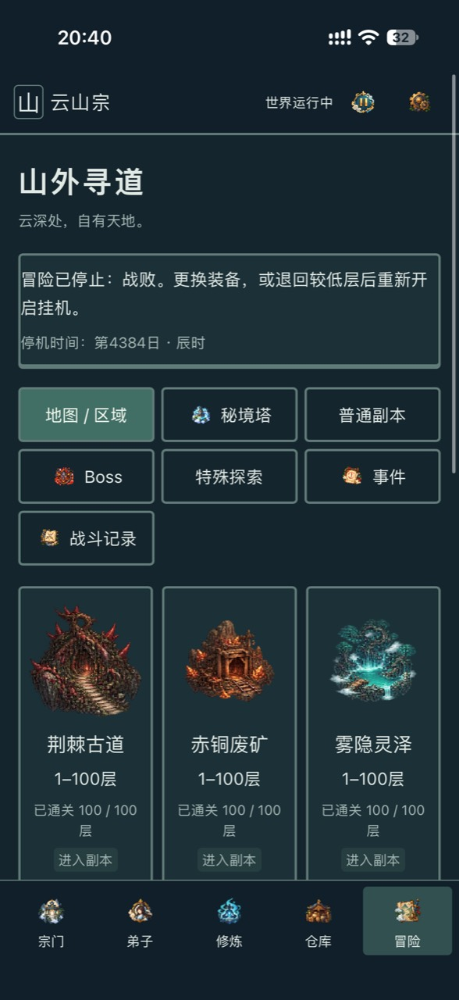
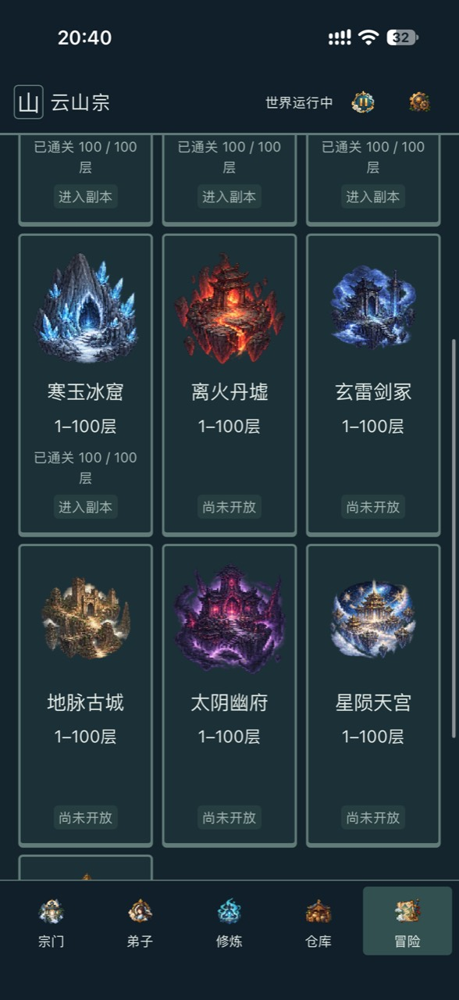
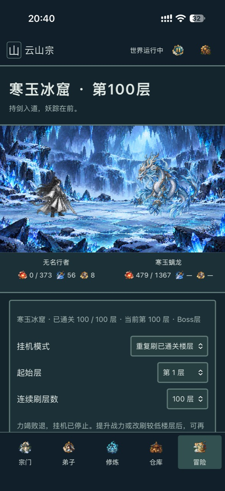

<div align="center">

# 云山宗 · 修仙 V2

**从一座山门开始，经营宗门、修习功法，走向更深的秘境。**

手机竖屏 · 宗门经营 · 自动战斗 · 像素修仙

**[下载 v0.3.0 · 网页／服务器版](https://github.com/BigHandsomeB/xiuxian-V2-yunshanzong/releases/tag/v0.3.0)**

[游戏预览](#游戏预览) · [世界概况](#世界概况) · [已实现功能](#已实现功能) · [本地运行](#本地运行) · [在线部署](#在线部署) · [后续开发计划](#后续开发计划) · [版本历史](#版本历史)

</div>

## 选择运行方式

| 独立版本 | 启动方式 | 下载与说明 |
| --- | --- | --- |
| **Windows 桌面版** | Windows 10/11 x64，完整解压后双击 EXE；无需另装 Python，不启动 HTTP 服务 | [Windows 发行版](https://github.com/BigHandsomeB/xiuxian-V2-yunshanzong/releases/tag/v0.3.0-windows) · [桌面说明](https://github.com/BigHandsomeB/xiuxian-V2-yunshanzong/blob/windows-desktop/docs/windows/README.md) · [独立 Windows 分支](https://github.com/BigHandsomeB/xiuxian-V2-yunshanzong/tree/windows-desktop) |
| **网页／服务器版** | Python 后端与浏览器；本机网页或服务器部署 | [网页／服务器发行版](https://github.com/BigHandsomeB/xiuxian-V2-yunshanzong/releases/tag/v0.3.0) · [本地运行](#本地运行) · [在线部署](#在线部署) |

两种运行方式并列独立发布，玩法内容同为 v0.3.0。Windows 使用 `v0.3.0-windows` 标签；网页／服务器版保留 `v0.3.0` 标签。已有存档先按对应说明备份并显式升级，发行包不包含玩家存档。

<!-- gameplay-screenshots:start -->
## 实机截图

宗门经营、修炼配装、仓库与副本战斗的真实手机画面。**左右滑动下方图列，点击图片查看大图。** 截图记录拍摄时的状态，当前开放内容以本文功能说明为准。

<table>
<tr>
<td align="center"><a href="docs/screenshots/01-sect-overview.jpg"></a></td>
<td align="center"><a href="docs/screenshots/02-sect-buildings.jpg"></a></td>
<td align="center"><a href="docs/screenshots/03-sect-crafting.jpg"></a></td>
<td align="center"><a href="docs/screenshots/04-cultivation-equipment.jpg"></a></td>
<td align="center"><a href="docs/screenshots/05-techniques-backpack.jpg"></a></td>
<td align="center"><a href="docs/screenshots/06-equipment-inventory.jpg"></a></td>
<td align="center"><a href="docs/screenshots/07-resource-inventory.jpg"></a></td>
<td align="center"><a href="docs/screenshots/08-adventure-map.jpg"></a></td>
<td align="center"><a href="docs/screenshots/09-dungeon-route.jpg"></a></td>
<td align="center"><a href="docs/screenshots/10-cold-jade-battle.jpg"></a></td>
</tr>
<tr>
<td align="center"><sub>01 · 宗门总览</sub></td>
<td align="center"><sub>02 · 山门与宗务</sub></td>
<td align="center"><sub>03 · 丹火与百工</sub></td>
<td align="center"><sub>04 · 修炼与配装</sub></td>
<td align="center"><sub>05 · 功法与背包</sub></td>
<td align="center"><sub>06 · 独立装备</sub></td>
<td align="center"><sub>07 · 仓库资源</sub></td>
<td align="center"><sub>08 · 冒险地图</sub></td>
<td align="center"><sub>09 · 副本路线</sub></td>
<td align="center"><sub>10 · 寒玉冰窟战斗</sub></td>
</tr>
</table>

<!-- gameplay-screenshots:end -->


云山宗是一款持续开发中的修仙宗门经营网页游戏。日常以资源、建筑和弟子岗位管理为主，冒险以独立场景中的单主角回合战斗为主。每一次炼丹、生产、掉落和突破，都连接同一份服务器存档。

当前版本为 **v0.3.0 · 法宝与功法秒制冷却（2026-10-18）**，内容标识`sect-artifacts-v1-6.3.0-r1`。[本次发行说明](docs/project/RELEASE-v0.3.0.md) · [已有存档升级](docs/project/UPGRADE-main-artifacts.md)。历史发行版[v0.2.0](https://github.com/BigHandsomeB/xiuxian-V2-yunshanzong/releases/tag/v0.2.0)保留。


## 游戏预览

顶部图列为用户提供的实机截图。以下展示游戏已接入的实际场景与角色素材；本地启动后可体验完整页面。

### 荆棘古道


### 赤铜废矿


### 雾隐灵泽


### 寒玉冰窟


### 离火丹墟


<table>
<tr><th>主角</th><th>荆棘山魈王</th><th>宗门资源</th><th>装备成长</th></tr>
<tr>
<td align="center"></td>
<td align="center"></td>
<td align="center"></td>
<td align="center"></td>
</tr>
</table>

## 世界概况

故事以云山宗为中心展开：山门内是药园、矿洞、丹鼎与炼器设施，山门外则是妖兽盘踞、材料与机缘并存的秘境。玩家安排弟子生产，构建灵植、养殖、灵膳与修炼之间的供给循环，逐步强化主角并推进副本。

- **当前可玩副本**：荆棘古道、赤铜废矿、雾隐灵泽、寒玉冰窟、离火丹墟，各 100 层。普通怪、精英与终层 Boss 分层出现，后续副本按前置通关解锁。
- **当前开放境界**：炼气与筑基，共 1–1000 级。金丹、元婴、化神、炼虚及总计 3000 级为配置预留，并未全部开放。
- **远景秘境**：玄雷剑冢、地脉古城、太阴幽府、星陨天宫、玄黄封仙台仍属于未开放内容。
- **核心循环**：岗位与供给 → 采集与生产 → 丹药与修炼 → 副本与掉落 → 装备、功法与宗门成长。

## 已实现功能

| 系统 | 当前能力 |
| --- | --- |
| 手机游戏界面 | 宗门、弟子、修炼、仓库、冒险五个主页面；浅色、深色与系统主题；详情弹窗与设置 |
| 宗门经营 | 建筑升级、住房与人口约束、招募、弟子岗位分配、仓容与供膳管理 |
| 生产与炼丹 | 采集、材料加工、丹药与装备制作；库存阈值自动生产与材料保留策略 |
| 灵植与养殖 | 四建筑生态玩法；17 种灵植、24 种养殖对象、27 种灵膳及对应饲料、加工和设施配置 |
| 修炼成长 | 击杀修为、等级属性成长、丹药修炼、里程碑与条件突破；已开放炼气、筑基 |
| 五大副本 | 共 500 层内容，独立进度与掉落；手动挑战、自动推层、定层回刷和首通奖励 |
| 战斗 | 回合、命中/暴击、护甲/破甲、元素、持续伤害、护盾、治疗与控制；13新+8旧特效分层表现 |
| 装备 | 前五副本60件装备的属性与特色机制；六槽装备、持久保存的随机属性、穿脱比较、强化、锁定/收藏、出售与分解、整包处理 |
| 功法 | 150部正式功法与特殊效果、身法/防御/绝技/终极自动施放及秒制冷却、次数；八功法槽、击杀成长、灵石与残页来源 |
| 法宝 | 五件Boss材料法宝、长时炼制、独立装备槽、投喂与击杀升级、强化、浮空外观与特殊效果 |
| 宗门活动 | 每日委托、贡献兑换、累计声望、前四副本首次 Boss 奖励的三选一定向宝箱 |
| 商店与图鉴 | 每日商店、物品详情、万宝图鉴及独立的说明编辑 |
| 时间与存档 | 世界暂停/继续、离线续算与收益报告、持久化存档、备份与恢复接口、请求重放保护 |
| 开发工具 | 素材集合、提示词、上传与裁切、人工审核、Runtime 发布；经济检查和原生 UI 测试 |

**当前边界**：弟子独立战斗与完整个体养成、后续境界、后五个副本、功法打坐/演武等预留入口尚未开放。部分最新功能仍待真实手机验收及长期经济平衡验证；代码检查不等于已完成这些验收。

## 本地运行

GitHub 保存代码和素材，不会自动启动游戏。下载后运行 Python 后端，再用浏览器打开游戏。无需启动素材管理器。

### 1. 准备环境

- Python **3.11 或更新版本**、Git。
- Linux 或 macOS；Windows 请在 **WSL 的 Linux 终端**中执行下面的命令。项目使用 Unix 文件锁，不能直接照搬到 Windows PowerShell。[Python 文件锁说明](https://docs.python.org/3/library/fcntl.html)
- 以下示例使用 Bash。安装依赖只需在自己的电脑或服务器上完成一次。

### 2. 下载源码

```bash
git clone https://github.com/BigHandsomeB/xiuxian-V2-yunshanzong.git
cd xiuxian-V2-yunshanzong
```

也可通过仓库的 **Code → Download ZIP** 下载并解压，然后在解压目录打开终端。

### 3. 安装依赖

```bash
python3 -m venv .venv
.venv/bin/python -m pip install -r requirements.txt
```

### 4. 创建自己的新档

```bash
.venv/bin/python -B -m tools.playable.setup_local
```

**只在第一次运行时执行。** 初始化使用当前完整内容配置，已有存档时拒绝覆盖。原作者的存档和口令不在仓库中，每个人下载后创建自己的进度。

### 5. 设置口令并启动

```bash
# 自动生成自己的随机口令；不要把它提交到 GitHub
export ASSET_MANAGER_TOKEN="$(.venv/bin/python -c 'import secrets; print(secrets.token_urlsafe(32))')"

# 仅在自己的终端查看，用于浏览器登录
printf '本机登录口令：%s\n' "$ASSET_MANAGER_TOKEN"

# 本地 HTTP 模式
export GAME_LOCAL_HTTP=1

# 启动游戏，终端保持运行
.venv/bin/python -B -m tools.playable.server
```

打开 **http://127.0.0.1:8000/game/**，输入刚才生成的口令即可游玩。停止服务时在终端按 **Ctrl+C**。手机不能通过自己手机的 `127.0.0.1` 访问电脑；需要下面的服务器部署方式。

### 6. 下次继续游玩

在项目目录重新执行“设置口令并启动”，**不要再次创建新档**。每次可生成新登录口令，存档仍保留；如果希望复用口令，可在自己的终端用隐藏输入设置：

```bash
read -r -s -p '输入自己的登录口令（至少24字符）：' ASSET_MANAGER_TOKEN
printf '\n'
export ASSET_MANAGER_TOKEN
export GAME_LOCAL_HTTP=1
.venv/bin/python -B -m tools.playable.server
```

运行数据保存在项目的 **`.game/`** 目录。更新源码或移动目录时保留这个目录；它不会上传到 GitHub。备份优先使用游戏提供的存档备份入口；需要复制整个目录时，先停止服务，再复制完整目录，避免遗漏正在写入的 SQLite 数据。

## 已有存档升级

已有存档请先停止自己的服务并备份，阅读[当前main显式升级步骤](docs/project/UPGRADE-main-artifacts.md)。不要删除`.game/`或重新初始化来代替升级。

## 在线部署

在线部署后，手机或其他电脑可以通过自己的 HTTPS 域名访问。**当前每个服务实例只有一份存档和一个访问口令**：同一个实例的访问者会操作同一份进度。适合私人实例或小范围体验；多人账号、各自独立存档和公开运营隔离尚未实现。

下面均为新环境的通用示例，域名、证书路径和账号需要替换为部署者自己的值，不包含原作者的服务器配置。

### 1. 准备自己的服务器

准备可运行 Python 3.11+ 的 Linux 主机、Git、Nginx，以及指向该主机的域名和有效 TLS 证书。下载源码、建立虚拟环境、安装依赖和创建新档，步骤与“本地运行”第2～4步相同。使用对项目运行目录有写权限的专用账号；不要复制别人的真实存档。

### 2. 启动 HTTPS 后端

在项目目录执行：

```bash
# 域名仅为示例；替换成自己的域名，不写协议和路径
export GAME_ALLOWED_HOSTS="game.example.com,localhost,127.0.0.1"

# HTTPS 模式不能启用本地 HTTP Cookie 设置
unset GAME_LOCAL_HTTP

# 自己设置至少24字符的随机口令，不使用公开示例口令
read -r -s -p '输入自己的登录口令（至少24字符）：' ASSET_MANAGER_TOKEN
printf '\n'
export ASSET_MANAGER_TOKEN

# 在自己的服务器安装在线部署所需的 WSGI 服务
.venv/bin/python -m pip install gunicorn

# 从一个工作进程开始，不按 CPU 数量自动扩张
.venv/bin/gunicorn --workers 1 --threads 1 --bind 127.0.0.1:8000 --timeout 60 'tools.playable.server:application()'
```

后端监听 **本机回环地址的8000端口**，由 Nginx 提供外部 HTTPS 入口。不要为这个流程修改源码监听地址或直接公开后端端口。

### 3. 配置 HTTPS 反向代理

下面是独立虚拟主机示例；替换域名和证书文件路径后，放入自己系统对应的 Nginx 配置目录。**不要覆盖已有网站的配置。**

```nginx
server {
    listen 443 ssl;
    server_name game.example.com;

    ssl_certificate     /path/to/your/fullchain.pem;
    ssl_certificate_key /path/to/your/privkey.pem;

    location / {
        # 不加尾部路径，保留 /game/ 等完整请求路径
        proxy_pass http://127.0.0.1:8000;
        proxy_http_version 1.1;

        proxy_set_header Host $http_host;
        proxy_set_header X-Forwarded-Proto $scheme;
        proxy_set_header X-Forwarded-For $remote_addr;

        # 存档备份接口允许的请求体大于普通玩法请求
        client_max_body_size 8m;
        proxy_read_timeout 60s;
    }
}
```

由可信代理覆盖 `X-Forwarded-Proto`，保留原始 Host；应用的可信主机配置应与自己的域名一致。配置路径是否保留取决于 `proxy_pass` 是否带 URI；本示例不带 URI。[Nginx 官方代理说明](https://nginx.org/en/docs/http/ngx_http_proxy_module.html#proxy_pass)

在自己的服务器上检查配置后再加载：

```bash
sudo nginx -t
# 仅在检查通过后执行
sudo systemctl reload nginx
```

系统没有 systemd 时，使用该系统对应的 Nginx 重载方式。浏览器访问 **https://game.example.com/game/**，替换为自己的域名，使用自己的口令登录。

### 4. 持续运行与维护

先用前台方式确认登录、静态素材和游戏页面正常，再通过自己的服务管理器保持后端运行。以下 systemd 模板可供有管理经验的部署者配置：

```ini
[Unit]
Description=Yunshanzong game instance
After=network.target

[Service]
Type=simple
User=YOUR_GAME_USER
WorkingDirectory=/absolute/path/to/xiuxian-V2-yunshanzong
EnvironmentFile=/absolute/private/path/yunshanzong.env
ExecStart=/absolute/path/to/xiuxian-V2-yunshanzong/.venv/bin/gunicorn --workers 1 --threads 1 --bind 127.0.0.1:8000 --timeout 60 'tools.playable.server:application()'
Restart=on-failure
RestartSec=5
Nice=10
UMask=0077

[Install]
WantedBy=multi-user.target
```

先替换账号、项目和私密环境文件路径。环境文件只放自己的 `ASSET_MANAGER_TOKEN` 与 `GAME_ALLOWED_HOSTS`，限制文件读取权限，不设置 `GAME_LOCAL_HTTP`，不要提交到仓库。部署者在自己的服务器安装服务模板后，可用 `systemctl daemon-reload` 和 `systemctl enable --now 自己的服务名` 启动；查看日志并监控内存、CPU和磁盘。

本地启动命令使用 Werkzeug 开发服务，在线示例改用 Gunicorn 调用现有 WSGI 工厂；Gunicorn 是部署者自行安装的可选依赖，不在现有游戏依赖文件中。此示例从一个工作进程开始，仍不代表项目已经具备多人运营隔离或通过并发负载验收。[Werkzeug 服务说明](https://werkzeug.palletsprojects.com/en/stable/serving/) · [Gunicorn 工厂入口说明](https://docs.gunicorn.org/en/21.0.1/run.html)

更新前停服务并备份自己的存档；确认兼容后再更新代码、依赖和重启。已有存档升级应按版本的显式迁移说明操作，不要删档重建来代替迁移。本文模板未在本次文档更新中实际部署到服务器，不是自动安装脚本。

### 多人独立游玩的边界

- **各自下载并本地运行**：每个人拥有自己的存档。
- **各自部署一个实例**：实例之间独立；同一台主机上的不同实例还需要单独端口、运行目录和代理配置，当前代码没有提供一键多实例入口。
- **所有人访问同一个实例**：共用一份进度；访问口令不是多人账号系统。
- **公开多人服务**：需要先实现玩家身份、存档隔离、权限与相应容量验证。GitHub Pages 只托管静态页面，不能直接运行本项目的 Python/SQLite 后端。[GitHub Pages 官方说明](https://docs.github.com/en/pages/getting-started-with-github-pages/what-is-github-pages)

## 素材管理器（可选）

单纯游玩不需要启动素材管理器。开发自己的素材时，可在已设置口令的终端中单独运行：

```bash
.venv/bin/python -B -m tools.asset_manager
```

访问 http://127.0.0.1:8001。它会建立自己的空元数据库，不含原项目的素材制作历史。游戏运行读取正式 Manifest 和公开图鉴索引；素材管理器不必与游戏一同运行。

## 项目结构

```text
src/
  core/           时间、存档、事务与基础验证
  application/    玩法命令、查询与系统组合
  systems/        宗门、战斗、修炼、生产等规则
  data/           物品、配方、副本与功法定义
  transport/      Flask HTTP 与存档接口
  rendering/      正式素材绑定与表现投影
  ui/             原生 HTML / CSS / JavaScript 手机界面
assets/
  runtime/        当前发布并被游戏使用的成品素材
  manifest.json   素材路径、版本、尺寸与校验值
  templates/      素材制作规格配置
  registry/       公开图鉴索引与空初始化配置
tools/            启动、素材开发与经济工具
tests/            隔离测试
balance/          战斗与经济基线
docs/             技术规则与发布说明
```

`tools/playable/` 提供游戏启动与升级工具，`tools/asset_manager/` 提供素材开发工具，`tools/economy/` 和 `balance/` 提供数值检查，`tests/` 保存 Python 和原生 JavaScript 测试。

技术栈：**Python · Flask · SQLite · Pillow · 原生 JavaScript**。日常经营采用图标与数量，战斗采用场景与角色；游戏数值以服务器 SQLite 事务为权威。

## 验证

```sh
.venv/bin/python -B -m unittest tests.systems.test_sect_activities tests.transport.test_sect_activities
.venv/bin/python -B -m unittest tests.systems.test_formal_techniques tests.systems.test_level_cultivation
```

全量 Python 测试入口为 `python -B -m unittest discover -s tests`。原生 JavaScript 测试在 `tests/*_test.js` 中，需要相应 JavaScript 运行环境；受限服务器优先分模块串行验证。

本次发布检查与资源边界见 [发布说明](docs/project/RELEASE.md)。手机视觉、长期平衡与测试统计按实际验证范围记录。

## 后续开发计划

先巩固五副本、生态经济、存档与手机体验，再按依赖逐步扩展：

| 方向 | 规划内容 |
| --- | --- |
| 后五副本 | 玄雷剑冢 → 地脉古城 → 太阴幽府 → 星陨天宫 → 玄黄封仙台；内容与解锁待设计 |
| 后续境界 | 金丹、元婴、化神、炼虚；现有 3000 级预留配置需逐步补齐并验证 |
| 功法培养 | 打坐与演武、资源和时间约束、成长节奏 |
| 弟子与宗门 | 个体养成、境界与独立战斗；继续完善经营与冒险的资源闭环 |
| 生产与装备 | 后续批次配方、孵化、精炼、符文方案 |
| 交付质量 | 长期数值平衡、实际手机验收、旧档兼容、真实界面截图与版本化更新 |

以上为规划，尚未全部实现或开放，也没有承诺具体上线日期。详细边界与交付顺序见 [ROADMAP.md](ROADMAP.md)。

## 版本历史

| 日期 | 主要更新 |
| --- | --- |
| 2026-10-17 | v0.2.0：离火丹墟100层、60装备特色、150功法机制、13新特效与旧档显式升级 |
| 2026-10-14 | 宗门每日委托、贡献与声望、Boss 定向宝箱；修复活动客户端命令；属性整数显示；首次完整游戏 GitHub 快照 |
| 2026-10-13 | 四建筑生态与灵膳、击杀修为及等级成长、150 部正式功法、万宝图鉴说明编辑 |
| 2026-10-12 | 寒玉冰窟、离线续算优化、战斗效果与追赶提示、灵泉灌溉、招募与配方界面完善 |
| 2026-10-11 | 宗门经营扩展、存档备份与客户端恢复、离线收益报告；副本内容持续完善 |
| 2026-10-10 | 六槽随机装备、荆棘古道掉落与怪物强度规则、副本图标、只读 UI 预览 |
| 2026-10-08–09 | 宗门经济与自动生产、世界暂停、主题和资源图标、战斗表现与素材流程完善 |
| 2026-10-06–07 | 完整手机游戏外壳、最小真实战斗、炼丹与修炼闭环 |
| 2026-10-03–05 | V2 时间与存档基础、玩法边界、资源和建筑基础、素材管理工具 |

详细历史见 [CHANGELOG.md](CHANGELOG.md)。历史条目整理自本地提交与实施记录；仓库从本次快照开始保留 Git 更新历史，不携带原工作区中的私密历史。

